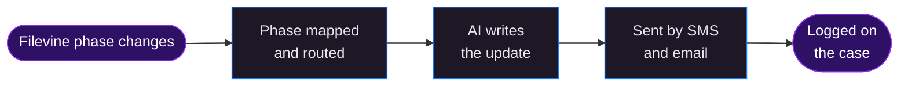

<!-- styled:v2 -->

**A Node.js webhook service and n8n workflow that turn every Filevine phase change into a plain-English client update by SMS and email.**

  
  
  
  
  
  
  
  

  <a href="#overview">Overview</a> ·
  <a href="#how-it-works">How it works</a> ·
  <a href="#key-features">Key features</a> ·
  <a href="#results">Results</a> ·
  <a href="#screens">Screens</a> ·
  <a href="#tech-stack">Tech stack</a>

---

## Overview

Keeping clients updated on case status took staff time and was easy to miss. We built a custom Node.js (TypeScript) webhook service triggered by Filevine phase changes, with n8n handling the messaging. Each phase is mapped to the right update, AI writes a plain-language message in the firm's tone, it is sent by SMS and email, and deadline tasks and an activity note are logged back in Filevine.

## The challenge

Clients called for updates, and staff had to remember to write and send a message every time a case moved forward.

## The solution

A TypeScript webhook service receives Filevine phase changes and maps them to update types. n8n routes each phase, AI writes the client message, Twilio and Gmail deliver it, and the result is logged on the case.

## How it works

1. **Filevine phase changes.** When a case moves phase in Filevine, a webhook calls the custom Node.js service.
2. **Phase mapped and routed.** The phase is mapped to an update type and routed: discovery, mediation or settlement.
3. **AI writes the update.** AI writes a plain-English update, a reminder or a closing letter in the firm's tone.
4. **Sent by SMS and email.** The message is delivered by Twilio SMS and Gmail at the same time.
5. **Logged on the case.** A note is posted back to Filevine so the team can see exactly what the client received.

## Key features

- Case phase mapped to the right update
- AI writes a plain-language message for the client
- Update sent by SMS and email
- Deadline tasks created in Filevine
- Activity logged back on the case

## Results

- Clients stay informed at every phase
- Fewer status calls to the office
- Every update recorded on the case

## Tech stack

      

## Screens

## Privacy

Client names and records are confidential. Every screen in this repository uses sample data, and source code that belongs to the client is not published.

## Links

- Case study on Lexvaxa: https://lexvaxa.com/work/filevine-case-status-automation

---

**Built by [Ch Muhammad Samiullah](https://github.com/samiullah156-creator)** · AI Automation Engineer and Full-Stack Developer at [Lexvaxa](https://lexvaxa.com)

⭐ Star this repo if you found it useful

